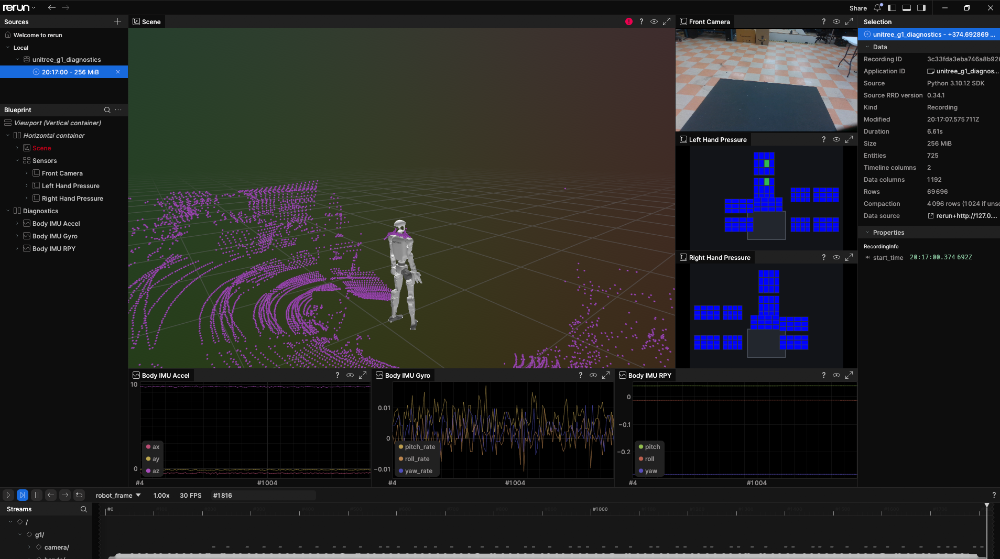
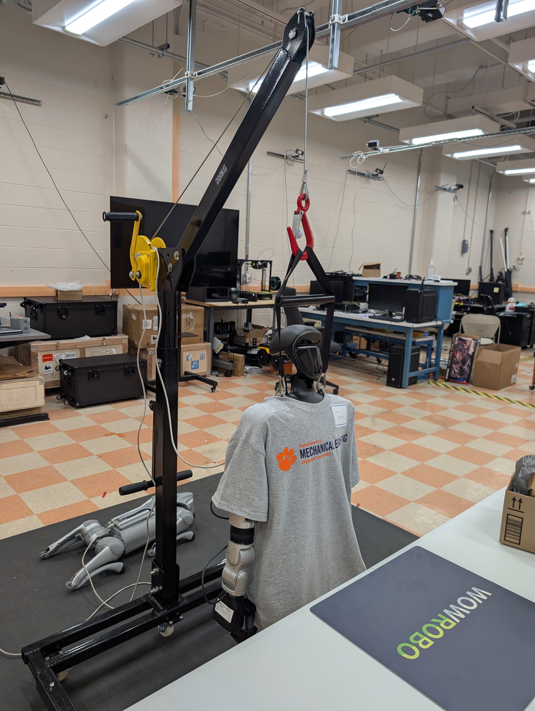
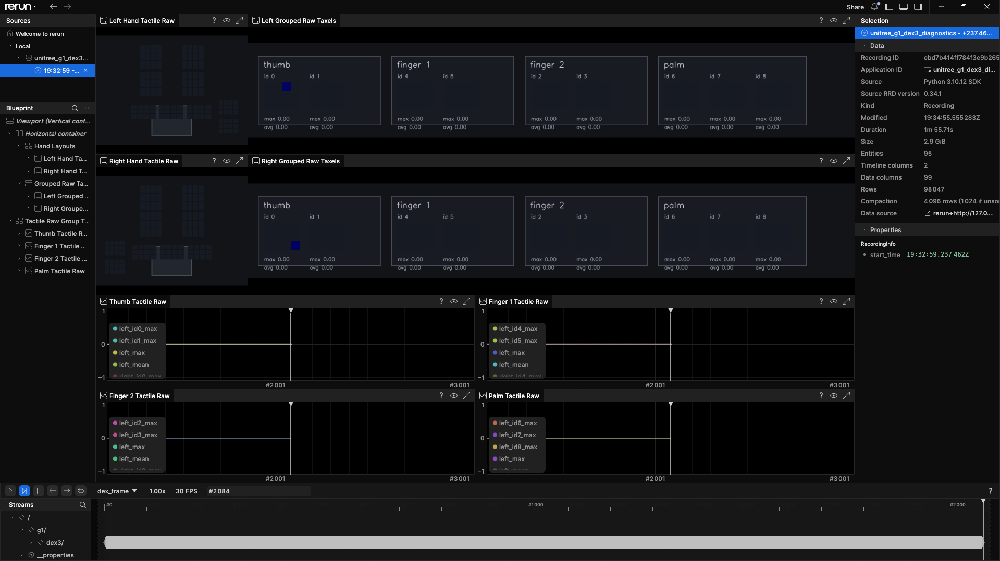

# g1-ros2

ROS 2 bring-up, diagnostics, bounded teleoperation, and dataset capture tools
for the DyCo AI Lab's Unitree G1 humanoid.

[](https://docs.ros.org/en/humble/)
[](https://support.unitree.com/home/en/G1_developer/about_G1)
[](LICENSE)
[](#project-status)

> [!IMPORTANT]
> This repository includes motion-capable code. Keep the G1 supported on its
> gantry during initial tests, clear the workspace, keep the remote/emergency
> stop available, and run the read-only checks before enabling motion.



## Purpose

`g1-ros2` provides a repeatable starting point for new lab users and controller
developers. Its core workflow is:

1. Connect a development PC to the G1 and verify the robot network.
2. Configure ROS 2 Humble and CycloneDDS for Unitree communication.
3. Discover and inspect body, hand, camera, LiDAR, IMU, and health messages.
4. Visualize the live robot and sensors in Rerun.
5. Run small, explicitly enabled Dex3 and upper-body teleoperation tests.
6. Record synchronized robot data and replay it without the robot connected.

The diagnostics path is read-only. Motion tests live in a separate package and
require explicit operator activation.

## Start Here: Before Every Development Session

First-time users must complete the
[Ubuntu 22.04 host installation](docs/install/README.md) before using this
checklist. For every robot session, perform these actions in order and stop if
a check fails:

1. **Secure the robot.** Put the G1 on the gantry, clear its motion area, and
   keep the wireless controller and emergency-stop access available.
2. **Power on.** Press the battery button once, then press it again and hold.
   Wait for startup to complete.
3. **Enter Development mode.** Press `L2 + R2`. Confirm that the development
   LED is green. This disables the stock Unitree walking controller.
4. **Choose the arm pose if needed.** Press `L2 + A` to put both arms and hands
   forward. Press `L2 + B` to cancel that pose.
5. **Connect the host PC.** Attach the robot Ethernet cable and confirm that
   the PC interface has `192.168.123.222/24`.
6. **Pass the network gate.** Run `ping -c 4 192.168.123.161`. Do not continue
   unless all four packets return.
7. **Source the ROS 2 environment.** Use the commands below from the repository
   root.
8. **Pass the ROS gate.** Confirm `/lf/lowstate` is present and publishing.
9. **Run read-only diagnostics.** Start Rerun and verify the URDF, camera,
   LiDAR, IMU, and Dex3 streams.
10. **Enable motion only from its runbook.** Complete the
    [hardware checklist](docs/hardware/README.md#pre-motion-check) and the
    [specific motion-test procedure](docs/teleop/README.md) before running a
    command with motion enabled.

```bash
cd ~/g1-ros2

# Activate exactly one Python environment:
source .venv/bin/activate
# conda activate g1-ros2

source /opt/ros/humble/setup.bash
source src/unitree_ros2/cyclonedds_ws/install/setup.bash
source install/setup.bash
export RMW_IMPLEMENTATION=rmw_cyclonedds_cpp
export CYCLONEDDS_URI="file://${PWD}/config/cyclonedds_g1.xml"

ping -c 4 192.168.123.161
ros2 topic info /lf/lowstate
ros2 topic hz /lf/lowstate
# After confirming a stable rate, press Ctrl+C.
ros2 run g1_rerun_bridge bridge
```

> [!CAUTION]
> Do not use Mode 8/climb, Mode 9/dance, or unknown wireless-controller
> commands. Some stock motions target basic hands and have not been validated
> with this robot's Dex3 hands. See the [controller startup and command
> allowlist](docs/controller/README.md).

## Supported Lab Robot

The current profile targets the lab's development-capable G1 configuration:

<p align="center">
  
</p>

<p align="center"><em>The DyCo AI Lab G1 in its supported development setup.</em></p>

| Component | Configuration |
| --- | --- |
| Robot | Unitree G1, 29 body DOF |
| Hands | Left and right Dex3-1, 7 motors per hand |
| LiDAR | Livox Mid360 |
| Camera | Intel RealSense D435i plus Unitree H264 RGB stream |
| Onboard computer | NVIDIA Jetson Orin NX |
| Development PC | Ubuntu 22.04, ROS 2 Humble |
| ROS middleware | CycloneDDS |

Do not assume these instructions apply unchanged to a 23-DOF G1, dummy hands,
another firmware version, or another lab network.

## What You Can Inspect

| System | Primary source | Current support |
| --- | --- | --- |
| Body joints and primary IMU | `/lf/lowstate` | Live ROS and animated URDF |
| Secondary IMU | `/lf/secondary_imu` | Live ROS and Rerun plots |
| Mid360 cloud and IMU | `/utlidar/cloud_livox_mid360`, `/utlidar/imu_livox_mid360` | Live ROS and 3D Rerun view |
| Dex3 state and tactile arrays | `/lf/dex3/left/state`, `/lf/dex3/right/state` | Live ROS, URDF, tactile diagnostics |
| Front RGB camera | Unitree H264 multicast | Live GStreamer decode in Rerun |
| RealSense depth | Onboard D435i | Isolated Foxy probe only; disabled from default bring-up |
| Battery, board, alarms, stop state | Unitree low-frequency topics | Topic inventory exists; readiness summary pending |

## Interfaces

### Whole-Robot Diagnostics

The main Rerun interface combines the live G1 model, Mid360 cloud, front RGB
camera, body IMU, and both Dex3 hands:

```bash
ros2 run g1_rerun_bridge bridge
```

### Dex3 Diagnostics

The focused hand interface groups raw tactile packets by physical pad and
plots their values over time:

```bash
ros2 run g1_rerun_dex dex_rerun
```



### Bounded Dex3 Motion Test

The first teleoperation milestone uses native Unitree SDK2. It starts read-only
unless `--enable-motion` is supplied:

```bash
# Read-only feedback check
ros2 run g1_teleop dex3_smoke enp0s31f6 --side right

# Motion-capable mode: only after completing the safety checklist
ros2 run g1_teleop dex3_smoke enp0s31f6 \
  --side right \
  --enable-motion
```

See the [teleoperation runbook](docs/teleop/README.md) before using the second
command.

## Quick Start

The tested host configuration is **Ubuntu 22.04 LTS on x86_64 with ROS 2
Humble**. For a new PC, complete the
[step-by-step host installation guide](docs/install/README.md) first. The
commands below are the condensed path for an already prepared Ubuntu host.

### 1. Clone the Repository and Upstream Dependencies

```bash
git clone https://github.com/DyCo-AI/g1-ros2.git
cd g1-ros2

sudo apt update
sudo apt install python3-vcstool
vcs import < dependencies.repos
```

The dependency manifest pins the Unitree ROS 2 messages and robot-description
repositories used by this workspace. Generated `build/`, `install/`, and `log/`
directories are not committed.

### 2. Install the Host Dependencies

The supported host baseline is Ubuntu 22.04 with ROS 2 Humble:

```bash
sudo apt update
sudo apt install \
  ros-humble-desktop \
  ros-humble-rmw-cyclonedds-cpp \
  ros-humble-rosidl-generator-dds-idl \
  python3-colcon-common-extensions \
  python3-rosdep \
  python3-pip \
  python3-venv \
  python3-gi \
  python3-gst-1.0 \
  gir1.2-gstreamer-1.0 \
  gstreamer1.0-tools \
  gstreamer1.0-libav \
  gstreamer1.0-plugins-good \
  gstreamer1.0-plugins-bad

/usr/bin/python3 -m venv --system-site-packages .venv
source .venv/bin/activate
python3 -m pip install -r src/g1_rerun_bridge/requirements.txt
```

This condensed example uses `venv`. A Python 3.10 Conda environment is also
supported; follow [Option B in the installation guide](docs/install/README.md#option-b-conda)
so ROS, OpenCV, and GStreamer remain visible inside the environment.

### 3. Build Unitree Messages and Lab Packages

```bash
source .venv/bin/activate
source /opt/ros/humble/setup.bash

cd src/unitree_ros2/cyclonedds_ws
/usr/bin/python3 -m colcon build --symlink-install \
  --cmake-args -DPython3_EXECUTABLE=/usr/bin/python3
source install/setup.bash
cd ../../..

python3 -m colcon build --symlink-install \
  --packages-select g1_rerun_bridge g1_rerun_dex
source install/setup.bash
```

The motion-capable `g1_teleop` package has a separate SDK2 build procedure in
the [teleoperation documentation](docs/teleop/README.md).

### 4. Prepare the Robot and Network

1. Support the G1 on the gantry.
2. Power on the battery: press once, then press again and hold. Wait for
   startup to complete.
3. Press `L2 + R2` to enter Development mode. This disables the stock Unitree
   walking controller.
4. Confirm the development-mode LED is green.
5. Optionally use `L2 + A` for the forward arm/hand development pose;
   `L2 + B` cancels it.
6. Connect the development PC by Ethernet.
7. Confirm the PC Ethernet address is `192.168.123.222/24`.
8. Verify the robot every session:

```bash
ping -c 4 192.168.123.161
```

Do not continue unless the ping check passes. See the complete
[network runbook](docs/network/README.md) for first-time configuration and
Jetson access. Before using the wireless controller, read the
[startup, Ready-mode demo allowlist, and prohibited-command
warnings](docs/controller/README.md). Do not use Mode 8/climb, Mode 9/dance,
or unknown stock commands with the installed Dex3 hands.

### 5. Source DDS and Check Messages

From the repository root:

```bash
source /opt/ros/humble/setup.bash
source src/unitree_ros2/cyclonedds_ws/install/setup.bash
source install/setup.bash

export RMW_IMPLEMENTATION=rmw_cyclonedds_cpp
export CYCLONEDDS_URI="file://${PWD}/config/cyclonedds_g1.xml"

ros2 topic list
ros2 topic info /lf/lowstate
ros2 topic hz /lf/lowstate
ros2 topic echo --once /lf/lowstate --field mode_machine
```

Then follow the [whole-robot bring-up](docs/bringup/README.md) to validate each
sensor and start Rerun.

## Saving Data

Raw ROS topics can already be captured with `ros2 bag record`. For example:

```bash
mkdir -p datasets
ros2 bag record -o datasets/g1_smoke \
  /lf/lowstate \
  /lf/secondary_imu \
  /lf/dex3/left/state \
  /lf/dex3/right/state \
  /utlidar/cloud_livox_mid360 \
  /utlidar/imu_livox_mid360
```

The planned V1 recording command will add:

- MCAP storage and named recording profiles.
- Rerun `.rrd` capture.
- Camera/depth synchronization.
- Hardware, firmware, calibration, and clock metadata.
- A 10-second automated smoke test and offline replay validation.

Until that workflow is complete, treat manually recorded bags as development
data rather than accepted lab datasets.

## Repository Layout

```text
config/                     CycloneDDS and robot profiles
docs/                       Lab runbooks and subsystem documentation
scripts/                    Network, calibration, and diagnostic utilities
src/g1_rerun_bridge/        Whole-robot ROS-to-Rerun diagnostics
src/g1_rerun_dex/           Focused Dex3 tactile diagnostics
src/g1_teleop/              Explicitly enabled bounded motion tests
third_party/                Local, ignored binary dependencies
dependencies.repos          Pinned upstream source dependencies
```

## Documentation

| Start here | Purpose |
| --- | --- |
| [Lab wiki](docs/README.md) | Documentation index and conventions |
| [Ubuntu 22.04 host installation](docs/install/README.md) | Clean-PC dependencies, build, environment, and pass criteria |
| [Whole-robot bring-up](docs/bringup/README.md) | Canonical startup and diagnostics procedure |
| [Wireless controller startup](docs/controller/README.md) | Power-on, Damp/Stand/Ready and Development paths, demo allowlist, and prohibited commands |
| [Robot network](docs/network/README.md) | Ethernet, static IP, ping, DDS, and Jetson SSH |
| [Hardware configuration](docs/hardware/README.md) | Robot variant, sensors, hip clamp, and active DOFs |
| [Rerun diagnostics](docs/rerun/README.md) | Whole-robot interface and troubleshooting |
| [Dex3 diagnostics](docs/dex3/README.md) | Tactile layout, calibration, and focused viewer |
| [Camera](docs/camera/README.md) | Unitree RGB and RealSense investigation |
| [LiDAR](docs/lidar/README.md) | Mid360 topics, rates, and frame checks |
| [IMUs](docs/imus/README.md) | Body, secondary, and Mid360 IMUs |
| [Basic teleoperation](docs/teleop/README.md) | Bounded hand test and safety procedure |
| [V1/V2 pilot roadmap](docs/pilots/README.md) | Acceptance criteria and remaining work |

## Project Status

| Milestone | Status |
| --- | --- |
| Robot LAN, ping, ROS 2 messages, and DDS discovery | Working |
| Live URDF, RGB camera, Mid360, IMUs, and Dex3 in Rerun | Working baseline |
| Focused Dex3 tactile diagnostics and calibration tools | Working baseline |
| Native SDK2 bounded hand test | Implemented and offline-tested; hardware acceptance pending |
| Automated subsystem readiness report | Planned |
| Native RealSense RGB/depth integration | In progress |
| 10-second MCAP + RRD recording and offline replay | Planned |
| Deadman-controlled basic teleoperation | Planned after deterministic motion tests |
| Locomotion | Out of scope for the initial pilot |

The detailed release gates are maintained in the
[pilot roadmap](docs/pilots/README.md). A feature is not considered validated
only because it compiles or appears in Rerun; hardware pass criteria and saved
evidence must also be completed.

## External References

- [Unitree G1 developer guide](https://support.unitree.com/home/en/G1_developer/about_G1)
- [Unitree G1 quick development guide](https://support.unitree.com/home/en/G1_developer/quick_development)
- [Unitree ROS 2](https://github.com/unitreerobotics/unitree_ros2)
- [Unitree SDK2](https://github.com/unitreerobotics/unitree_sdk2)
- [Unitree G1 robot description](https://github.com/unitreerobotics/unitree_ros/tree/master/robots/g1_description)
- [RoboStore G1 startup guide](https://robostore.com/blogs/news/unitree-g1-startup-guide-essential-steps-for-setup-calibration-and-control)

The Unitree documentation is authoritative for robot operation and SDK
behavior. Third-party startup material is linked as supplementary onboarding
context and must not override Unitree safety or firmware-specific guidance.

## License

Lab-authored code and documentation are released under the [MIT License](LICENSE).
Upstream Unitree repositories, robot assets, SDK libraries, and other external
dependencies retain their own licenses.
