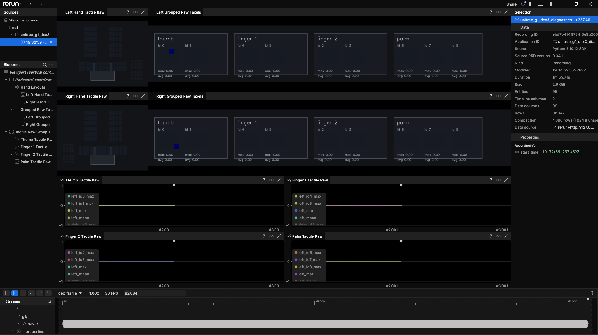
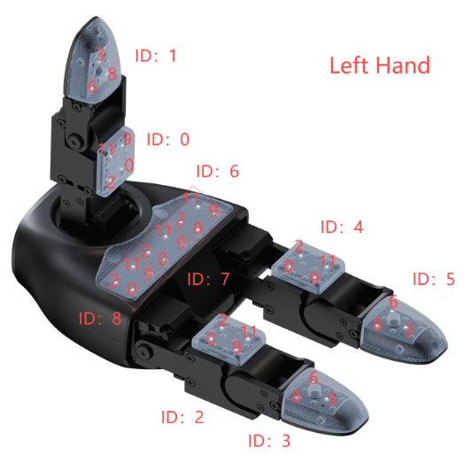
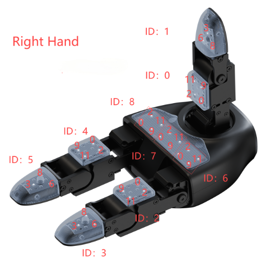
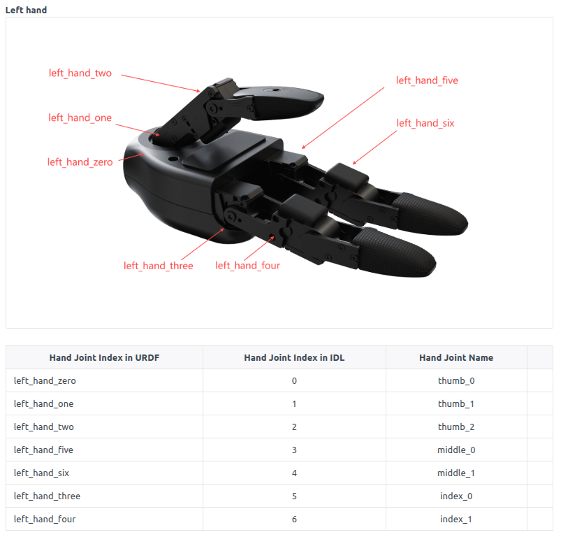
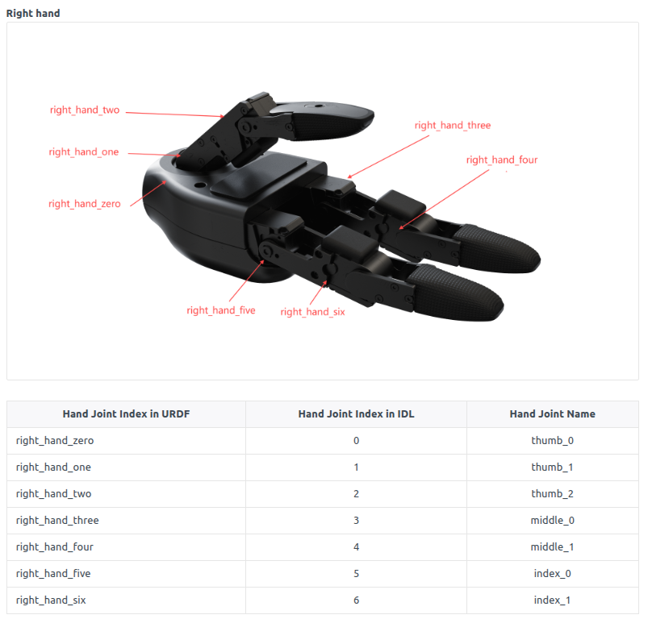

# Dex3 Tactile Diagnostics

This page documents the Unitree G1 Dex3 hand tactile diagnostics used in this
workspace. The current tools are read-only by default: they subscribe to hand
state topics and visualize raw tactile sensor output in Rerun.

## Source References

- [Unitree G1 Dex3 developer page](https://support.unitree.com/home/en/G1_developer/dexterous_hand)
- [Unitree Dex3 SDK example](https://github.com/unitreerobotics/unitree_sdk2/blob/main/example/g1/dex3/g1_dex3_example.cpp)
- [Unitree Dex3 product page](https://unitree-robot.com/mobile/Dex3-1/)
- [`dex3_pressure_tools`](https://github.com/sri299792458/dex3_pressure_tools/tree/main/dex3_pressure_tools), used as a reference for the untouched-baseline, raw-audit, and guided mapping-check workflow

The Unitree product page describes Dex3-1 as a three-finger dexterous hand with
7 DoF and optional tactile sensor arrays. It also lists 9 pressure sensor
packets per hand and 33 total tactile sensors.

## ROS Topics

Current observed G1 Dex3 hand topics:

| Topic | Message type | Use |
| --- | --- | --- |
| `/lf/dex3/left/state` | `unitree_hg/msg/HandState` | Left hand motor state, tactile packets, temperatures, IMU fields. |
| `/lf/dex3/right/state` | `unitree_hg/msg/HandState` | Right hand motor state, tactile packets, temperatures, IMU fields. |

Inspect the message shape:

```bash
ros2 interface show unitree_hg/msg/HandState
ros2 interface show unitree_hg/msg/PressSensorState
```

Quick stream check:

```bash
ros2 topic info /lf/dex3/left/state
ros2 topic info /lf/dex3/right/state
ros2 topic hz /lf/dex3/left/state
ros2 topic hz /lf/dex3/right/state
```

## Run the Dex3 Rerun Diagnostic

From the workspace root, build and source the package:

```bash
source /opt/ros/humble/setup.bash
colcon build --symlink-install --packages-select g1_rerun_dex
source install/setup.bash
```

Run the focused Dex3 GUI:

```bash
ros2 run g1_rerun_dex dex_rerun
```

Keep both hands untouched when the node starts. The GUI collects the first
`taxel_baseline_samples` valid samples as a baseline.

For later terminals, source both ROS and the workspace before running a tool:

```bash
source /opt/ros/humble/setup.bash
source install/setup.bash
```

Current Rerun layout:



## Rerun Panels

| Panel | What it shows |
| --- | --- |
| `Left Hand Tactile Raw` | Human-readable left-hand pad layout. |
| `Right Hand Tactile Raw` | Human-readable right-hand pad layout. |
| `Left Grouped Raw Taxels` | One-row raw left-hand tactile view grouped by physical pad. |
| `Right Grouped Raw Taxels` | One-row raw right-hand tactile view grouped by physical pad. |
| `Thumb Tactile Raw` | Time series for left/right thumb group max/mean and per-ID max. |
| `Finger 1 Tactile Raw` | Time series for left/right finger 1 group max/mean and per-ID max. |
| `Finger 2 Tactile Raw` | Time series for left/right finger 2 group max/mean and per-ID max. |
| `Palm Tactile Raw` | Time series for left/right palm group max/mean and per-ID max. |

## Tactile Packet Layout

Unitree's Dex3 docs label each physical tactile packet as an ID. Each packet
contains `pressure[12]`. In this project we use the following pad grouping:

| Physical region | Packet IDs |
| --- | --- |
| Thumb | `0`, `1` |
| Finger 1 | `4`, `5` |
| Finger 2 | `2`, `3` |
| Palm | `6`, `7`, `8` |

The grouped raw taxel panels show one physical region per group. Inside each
group, each packet ID is displayed as a 3x4 matrix corresponding to
`pressure[0]` through `pressure[11]`.

Use the Unitree figures below while validating the mapping. The red `ID`
labels identify `press_sensor_state[ID]`; the smaller numbers on each pad are
indices into that packet's `pressure[12]` array.

### Tactile Layout





### Joint Layout

The joint figures are useful when checking the seven hand motor states, but
joint IDs are separate from tactile packet IDs.





## Raw Units

The Dex3 tactile fields are not calibrated Newtons or Pascals in this project.
Treat them as raw tactile sensor values.

Unitree's documentation note, as captured during setup:

| Raw value | Meaning |
| --- | --- |
| `>= 100000` | Valid tactile value. |
| `30000` | Invalid/no-value marker. |
| `100000 -> 10.0000` | Recommended display scaling. |

Current displayed value:

```text
scaled_tactile_raw = max(raw - baseline, 0) / 10000
```

This is a dimensionless, baseline-subtracted display value. Do not label it as
force or pressure unless a separate calibration has been performed.

## Visual Processing

The Rerun image panels apply display-only processing:

1. Collect untouched baseline samples per taxel.
2. Subtract the baseline.
3. Clamp negative values to zero.
4. Divide by `taxel_pressure_scale`.
5. Smooth with `taxel_smoothing_alpha`.
6. Apply `taxel_pressure_deadband` to keep idle pads dark.
7. Apply a jet-style colormap.
8. Apply display-only spread/fill so one hot taxel reads visually like a pad
   contact.

The raw scalar/bar-chart streams are still logged separately under
`g1/dex3/<side>/raw/sXX/*`.

## Baseline and Packet-ID Calibration

In this runbook, calibration means establishing an untouched baseline and
validating the physical-to-digital taxel mapping. It does not convert readings
to force or pressure units.

The procedure combines the median-baseline and positive-delta method used by
the referenced `dex3_pressure_tools` project with the Unitree validity and
display-scaling rules used in this workspace:

```text
valid = finite(raw) and raw >= 100000 and abs(raw - 30000) > 1000
baseline = median(valid untouched samples)
delta = max(raw - baseline, 0)
display_value = delta / 10000
```

The median makes the baseline resistant to an occasional startup spike. The
`30000` value is treated as an invalid/no-value sentinel. The division by
`10000` is display scaling only.

### Before Starting

1. Put the G1 on the gantry and enter development mode.
2. Confirm the PC can ping `192.168.123.161`.
3. Remove all contact from both hands and place them where nothing can brush
   the tactile pads.
4. Confirm both state topics publish continuously.

```bash
ros2 topic hz /lf/dex3/left/state
ros2 topic hz /lf/dex3/right/state
```

### Run Rerun and the Calibration Script

The guided calibration script can run while the Rerun Dex GUI is open. Both
tools are read-only subscribers to `/lf/dex3/left/state` and
`/lf/dex3/right/state`.

Terminal 1, visual GUI:

```bash
source /opt/ros/humble/setup.bash
source install/setup.bash
ros2 run g1_rerun_dex dex_rerun
```

Terminal 2, guided calibration:

```bash
source /opt/ros/humble/setup.bash
source install/setup.bash
./scripts/calibrate_dex3_taxels.py --side both
```

Recommended order:

1. Start `g1_rerun_dex`.
2. Keep both hands untouched while its baseline is collected.
3. Wait until the Rerun panels look dark/stable.
4. Start `calibrate_dex3_taxels.py`.
5. Keep hands untouched again when the script prompts for baseline.
6. Use the left/right tactile layout images above to locate the requested ID.
7. Press only that pad, then press Enter as instructed.
8. Hold a steady touch for the default two-second collection window.
9. Watch Rerun and confirm the same packet ID and hand region respond.
10. Release the pad and confirm the time series returns close to baseline
    before continuing.

The script:

1. Prompts for an untouched baseline.
2. Prompts you to press each documented pad ID.
3. Records the strongest responding packet ID and taxel ID.
4. Reports `PASS` when the strongest packet matches the expected ID.
5. Saves a JSON report under `datasets/`.

Example output shape:

```text
PASS: expected ID 0, strongest ID 0 taxel 11 value 2.384
CHECK: expected ID 1, strongest ID 0 taxel 8 value 1.102
```

Treat `CHECK` as a reason to repeat the touch carefully before changing the
mapping.

### Pass Criteria

A hand passes the mapping check when:

1. Every expected packet ID `0..8` reports `PASS`.
2. The left and right Rerun hand layouts are mirrored correctly.
3. The strongest response appears in the physical pad being touched.
4. The signal rises clearly above idle noise and returns close to baseline
   after release.
5. The JSON report is saved under `datasets/` with the test date and results.

A `CHECK` result is not automatically a failed sensor. Repeat the test with a
more isolated touch. If the same wrong ID repeatedly wins, record the evidence
before changing the software mapping.

## Complete Dex3 Smoke Test

1. Put the robot on the gantry and enter development mode.
2. Confirm the PC can ping the robot.
3. Source ROS and the workspace.
4. Run `ros2 run g1_rerun_dex dex_rerun`.
5. Keep both hands untouched until the baseline is ready.
6. Press one physical pad at a time.
7. Confirm the hand-shaped panel lights the expected region.
8. Confirm the grouped raw panel lights the expected packet ID.
9. Confirm the bottom time-series group rises and returns to baseline.
10. Run `./scripts/calibrate_dex3_taxels.py --side both` and retain the JSON
    report with the lab session.

## Calibration to Physical Units

The current diagnostic is for raw tactile checks, not physical force/pressure
measurement. To calibrate into physical units:

1. Apply known loads with a force gauge or calibrated weights.
2. Record raw response per packet ID and taxel.
3. Fit a per-taxel or per-pad conversion model.
4. Validate repeatability across multiple contact points and hand poses.
5. Only then label outputs as Newtons, grams-force, or Pascals.

Until this is done, use labels like `tactile raw`, `scaled tactile raw`, or
`relative contact intensity`.

## Troubleshooting

| Symptom | Likely cause | Check |
| --- | --- | --- |
| No panels update | ROS topic not publishing or workspace not sourced. | `ros2 topic hz /lf/dex3/left/state` |
| All pads light at startup | Baseline was collected while touching the hand. | Restart the node with hands untouched. |
| Wrong packet ID lights | Touch location is ambiguous, mapping mismatch, or hand side mirrored incorrectly. | Repeat with guided calibration script. |
| One taxel only lights | Raw sensor response is localized. | Display spread/fill is only visual; inspect grouped raw matrix. |
| Values never return to zero | Baseline drift or contact remains. | Increase baseline samples or rerun with the hand untouched. |

## TODO

- [ ] Run `./scripts/calibrate_dex3_taxels.py --side both` on the real G1.
- [ ] Confirm tactile packet IDs `0..8` match the Unitree left-hand diagram.
- [ ] Confirm tactile packet IDs `0..8` match the Unitree right-hand diagram.
- [ ] Verify each response returns close to baseline after release.
- [ ] Save the calibration JSON under `datasets/` and link it from the lab test
  record.
